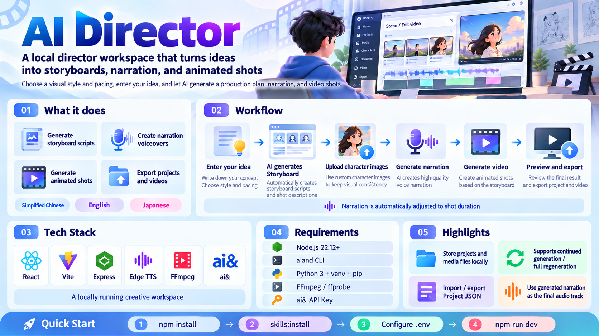

# AI Director

A local director's workspace that turns an idea into a storyboard, voiceovers, and animated shots.

Choose a visual style and pacing, describe your idea, and let AI draft the production plan. Review characters, generate and time-fit narration, then create videos with your narration and character images as references.

Built with **React, Vite, Express, Edge TTS, FFmpeg, and ai&**. The interface supports **Simplified Chinese, English, and Japanese**.

## Requirements

Install these tools before starting:

| Tool | Requirement |
| --- | --- |
| Node.js and npm | Node.js **22.12 or newer** |
| ai& CLI | `aiand` available on your `PATH` |
| Python | Python 3 with `venv` and `pip`, for Edge TTS |
| FFmpeg | `ffmpeg` and `ffprobe` available on your `PATH`; MP3 encoding requires `libmp3lame` |
| ai& account | An API key with access to the configured text and video models |

Install the ai& CLI using its [official installation instructions](https://docs.aiand.com/cli/):

```sh
npm install -g @aiand/cli
aiand --version
```

The app supplies `AIAND_API_KEY` from `.env` to the CLI, so a separate `aiand login` is not required for this workflow.

The commands below use a macOS/Linux shell. On Windows, use a WSL environment with these dependencies installed inside WSL.

## Quick start

Run all commands from the project root.

### 1. Install dependencies and the project Skill

```sh
npm install
npm run skills:install
npm run skills:verify
```

The required **`direct-h3-storyboards`** Skill is included in [`skills/direct-h3-storyboards/`](skills/direct-h3-storyboards/). The installer copies its instructions, references, JSON template, validator, tests, and agent metadata into:

```text
.local/skills/direct-h3-storyboards/
```

No personal or global Skills directory is required. Skill installation is local and makes no network requests. After updating the bundled Skill, run `npm run skills:install` again.

Set up the Python environment used for voice generation:

```sh
python3 -m venv .venv
.venv/bin/python -m pip install -r requirements-tts.txt
```

Verify that the media tools are installed:

```sh
ffmpeg -version
ffprobe -version
```

### 2. Add your API key to `.env`

Create the local environment file:

```sh
cp -n .env.example .env
```

Open `.env` and replace the placeholder:

```dotenv
AIAND_API_KEY=your-aiand-api-key
```

Keep an existing `.env` if you have already configured it. The file is ignored by Git and loaded only by the backend. Do not put API keys in a `VITE_` variable: those variables can be exposed in the browser bundle.

Optional overrides are documented in [`.env.example`](.env.example):

| Variable | Purpose |
| --- | --- |
| `AIAND_BIN` | Path to the `aiand` executable |
| `DIRECTOR_SKILL_PATH` | A custom `direct-h3-storyboards` directory; relative paths resolve from the project root |
| `EDGE_TTS_PYTHON` | Python executable with `edge-tts` installed; defaults to `.venv/bin/python` |
| `FFMPEG_BIN` | Path to `ffmpeg` for narration checks, speed adjustment, and final video audio |
| `FFPROBE_BIN` | Path to `ffprobe` for video duration checks |

The default text model is `deepseek-ai/deepseek-v4.1-flash`; video generation uses `minimaxai/minimax-h3` through the [ai& Videos API](https://docs.aiand.com/api/videos/).

### 3. Start the app

```sh
npm run dev
```

Open **[http://127.0.0.1:5173/](http://127.0.0.1:5173/)**.

This command starts both services:

- **Vite frontend:** `http://127.0.0.1:5173`
- **Express backend:** `http://127.0.0.1:3001`

The frontend proxies `/api` requests to the local backend. Keep the terminal running while using the app. Both services are intended for local use.

## Creating a project

1. **Write the brief.** Choose realistic 3D, Japanese anime, or 2.5D, then choose a 5- or 10-second shot pace and enter your idea.
2. **Generate the script.** The app loads the director Skill, invokes the ai& CLI, and validates the returned project JSON. A dedicated processing screen shows actual task stages.
3. **Prepare characters.** Copy a character's image prompt, generate the image in your preferred external service, upload it, and click **Save image**. The app does not generate character images itself.
4. **Generate voiceovers.** Edit each shot's dialogue, choose a voice, and generate individual recordings or the full list.
5. **Generate videos.** Review shot prompts, first-frame prompts, duration, and aspect ratio. Each video uses its current narration and the saved images of characters named in the prompt. A shot without characters needs a scene reference image.
6. **Preview and export.** Use the sequential audio/video players, download generated files as ZIP archives, and save the project JSON.

### Automatic voice duration fitting

Every newly generated voiceover is checked against the shot's current duration, including duration changes made in the storyboard workspace.

- Audio that already fits stays at its original speed.
- Overlong audio is accelerated with FFmpeg's `atempo` filter. The initial speed multiplier is **original duration / target duration**.
- The result is measured again and corrected if needed. A small silent tail fills any remaining gap so the adjusted recording reaches the target duration; spoken content is not cut to force a fit.
- The interface shows the original duration, final duration, and applied speed. These values are included in the exported project JSON.
- Duration checks use decoded audio samples, avoiding false failures caused by MP3 encoder padding. The same measurement is used before video submission and when restoring narration into the final video.

Original TTS files are retained in the local cache. Changing a target duration can reuse the original recording rather than requesting the same text and voice again. Existing recordings are checked when you regenerate them.

### Video generation and stopping

Batch video generation offers two modes:

- **Continue generation:** keep previous results and generate missing or modified shots.
- **Regenerate from scratch:** regenerate all eligible shots, retaining old videos until replacements succeed.

Generation dialogs show per-item status. Stopping voice generation also cancels the active local worker. For video, stopping prevents further submissions; tasks already submitted to ai& cannot be canceled and may continue processing. Existing task IDs are retained for recovery.

Video generation can incur API charges. Review the account pricing shown in the workspace. Before generating videos, accept the video service terms yourself in the ai& console if required.

The final MP4 uses the generated narration as its audio track. FFmpeg preserves the video's encoded picture stream while restoring the narration; provider-original video files are retained locally.

## Saving and reopening work

Use **Save project JSON** to export edited dialogue, prompts, character images, voiceovers, timing metadata, and video task IDs and paths. On the home screen, use **Load project JSON** to reopen it without submitting new generation requests.

| Data | Storage |
| --- | --- |
| Brief and interface language | Browser local storage |
| Uploaded images, workspace edits, and generated audio | Browser IndexedDB |
| Original and adjusted MP3 files | `.local/audio/` |
| Video task records, source videos, and final MP4 files | `.local/videos/` |
| Installed Skill copy | `.local/skills/direct-h3-storyboards/` |

Project JSON can carry saved character images and voiceovers. Videos remain separate local files: download the video ZIP and retain `.local/videos/` when moving to another computer. Clearing browser data removes browser-local drafts and workspace records.

Script-generation task records are held in backend memory. Export a completed project before restarting the backend. Imported projects never automatically replay paid submission queues.

The bottom-right language button switches between **简体中文 / English / 日本語** and remembers the selection. It changes interface copy only; dialogue, character names, prompts, project content, voice selection, and read-aloud language remain independent. The bundled director Skill intentionally generates Chinese production prompts while preserving the original language of names, dialogue, and lyrics.

## How Skills are loaded

The backend resolves the director Skill in this order:

1. `DIRECTOR_SKILL_PATH`, when explicitly configured.
2. The installed project copy in `.local/skills/direct-h3-storyboards/`.
3. The bundled source in `skills/direct-h3-storyboards/`.

The backend explicitly reads the Skill's instructions, required references, and project template into the model context, then runs `scripts/validate_storyboard.mjs` on the output. It does not rely on automatic Skill discovery by the CLI.

See [`skills/README.md`](skills/README.md) for the included files, installation behavior, and standalone validation instructions. The Skill also describes broader voice/music planning workflows; this app currently executes Edge TTS and ai& MiniMax H3, not those additional generators.

## Development commands

```sh
npm run dev            # Run the frontend and backend with file watching
npm run skills:install # Install the bundled Skill in this project
npm run skills:verify  # Compare the installed Skill with the bundled files
npm test               # Run application regression tests
npm run test:skills    # Run the bundled storyboard-validator tests
npm run build          # Build the frontend into dist/
npm start              # Serve the built frontend and API on port 3001
```

For a local production build, run `npm run build` followed by `npm start`, then open **http://127.0.0.1:3001/**.

Application tests use mocks or local media fixtures instead of calling paid generation services. FFmpeg media tests require FFmpeg.

## Troubleshooting

| Problem | What to check |
| --- | --- |
| Missing Skill or reference files | Run `npm run skills:install` and `npm run skills:verify`; check any `DIRECTOR_SKILL_PATH` override. |
| `aiand` cannot start | Run `aiand --version`; check your `PATH` or set `AIAND_BIN`. |
| Script generation fails | Check the backend's `AIAND_API_KEY`, model access, and network connection. Validation can trigger up to two model retries. |
| Edge TTS cannot start | Reinstall `requirements-tts.txt` into `.venv`, or point `EDGE_TTS_PYTHON` to the correct environment. |
| Duration fitting or video audio processing fails | Check `ffmpeg -version`, `ffprobe -version`, and the corresponding environment overrides. |
| No video generation access | Check your ai& account balance, model access, and video service terms. |
| An imported video is unavailable | Restore its original `.local/videos/` files or use the downloaded MP4 backup. Import does not regenerate it. |
| A video submission has an uncertain status | Check the ai& console before creating another task to avoid duplicate submissions. |

## Repository layout

```text
src/                         React interface, translations, and workspace logic
server/                      Local API, CLI integration, media processing, and tests
skills/direct-h3-storyboards/ Bundled director Skill and validator
scripts/install-skills.mjs   Project-local Skill installation and verification
.env.example                 Environment template without credentials
requirements-tts.txt         Python dependency for Edge TTS
.local/                      Local runtime files and generated media (Git-ignored)
```

## Publishing the source

Include `skills/`, `scripts/`, application source, tests, lockfile, `.env.example`, and this README. Keep your real `.env`, `.venv/`, `node_modules/`, `.local/`, and generated project exports private. Script briefs go to ai&, voiceover text goes to Microsoft's Edge TTS service, and video reference media goes to ai& when generation is requested.

Check already tracked files before making the repository public:

```sh
git ls-files .env .local .venv artifacts
```

Ignore rules do not remove files that are already tracked or erase earlier commits. Review any existing generated videos, project JSON, prompt notes, or credentials in the repository history before changing its visibility.

## License

[Apache License 2.0](LICENSE).
